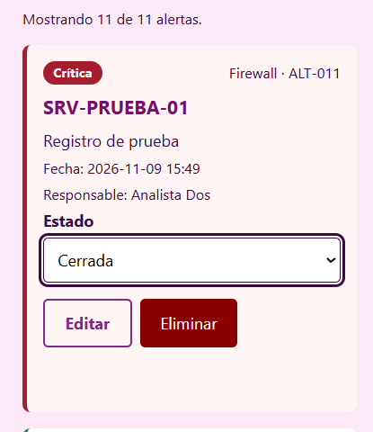
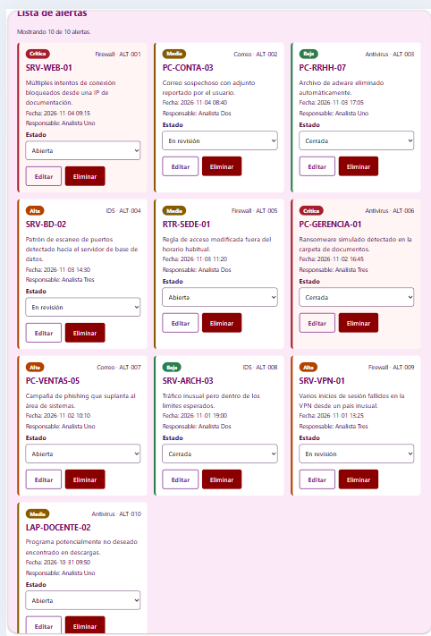
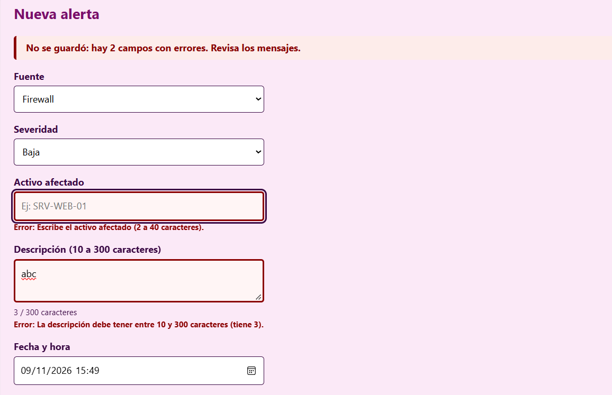
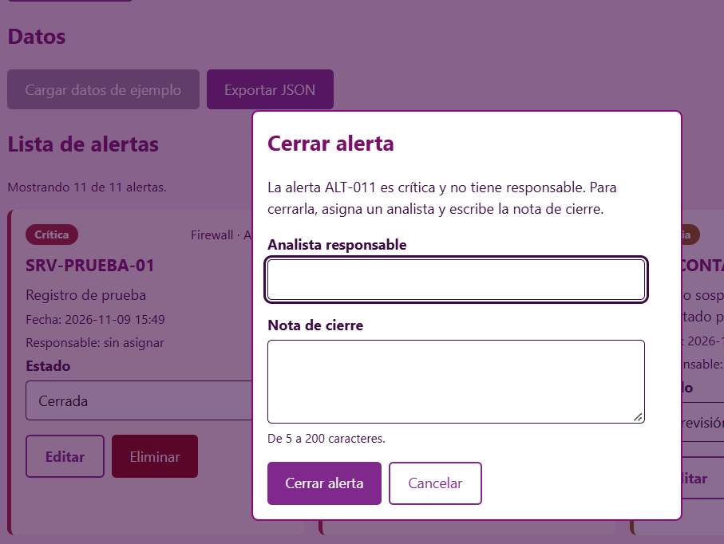
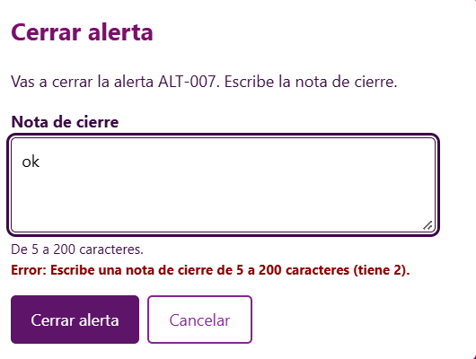
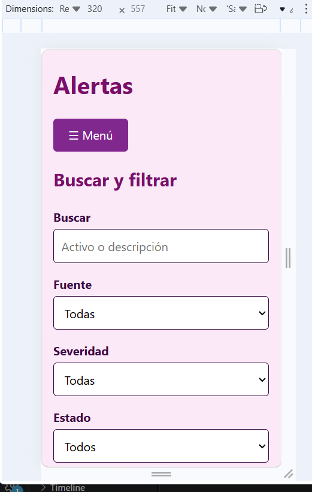

# Panel de Alertas SOC

Proyecto de Programación II (IC010404) · Equipo 3

**Integrantes:** León Rosales Ana María, Torres Sangama Ana Paula

Panel web para registrar y consultar alertas de seguridad (firewall, antivirus, IDS, correo). Está hecho solo con HTML, CSS y JavaScript, sin frameworks ni librerías.

**Sitio publicado (GitHub Pages):** https://anitaleon2025.github.io/Panel-Alertas-SOC/

## Etapas

- [x] E1 Estructura y navegación — [PR #1](https://github.com/AnitaLeon2025/Panel-Alertas-SOC/pull/1) · v0.1
- [x] E2 Diseño responsive — [PR #2](https://github.com/AnitaLeon2025/Panel-Alertas-SOC/pull/2) · v0.2
- [x] E3 Registro y presentación de datos — [PR #3](https://github.com/AnitaLeon2025/Panel-Alertas-SOC/pull/3) · v0.3
- [x] E4 Interfaz, validación y usabilidad — [PR #4](https://github.com/AnitaLeon2025/Panel-Alertas-SOC/pull/4) · v0.4
- [x] E5 Integración y entrega — [PR #5](https://github.com/AnitaLeon2025/Panel-Alertas-SOC/pull/5) · v1.0

## Qué hace el sistema

- **Panel:** contadores por severidad y estado, barra de proporción y las 5 últimas alertas.
- **Registrar alerta:** formulario con validación y mensajes junto a cada campo.
- **Alertas:** tarjetas con búsqueda, filtros por fuente, severidad y estado, orden, edición, eliminación con confirmación, cambio de estado, datos de ejemplo y exportación a JSON.
- **Reglas propias:** una alerta crítica no puede cerrarse sin responsable, y al cerrar una alerta se pide una nota de cierre.

## Documentación

- Fichas de investigación: [`docs/investigacion/`](docs/investigacion/)
- Revisión de seguridad: [`docs/seguridad.md`](docs/seguridad.md)
- Pruebas manuales: [`docs/pruebas.md`](docs/pruebas.md)

## Capturas

**Panel con datos**

**Lista de alertas**

**Validación en el formulario**

**Regla: crítica sin responsable**

**Nota de cierre**

**Vista móvil**

